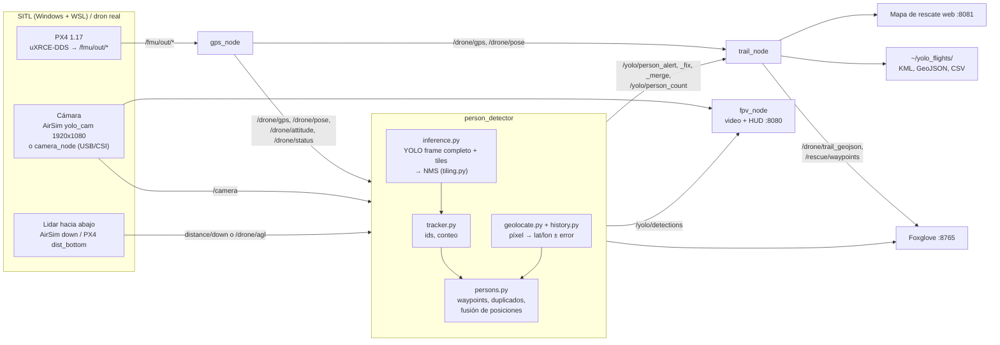

# YOLO — detección de personas + GPS + recorrido (demo de vuelo manual)

El dron se vuela **a mano con la radio** y, mientras tanto:

- YOLO detecta **personas cercanas y lejanas** en la cámara (frame completo + *tiling*).
- Cada persona se cuenta **una sola vez** mientras siga a la vista (`/yolo/person_total`) y
  cada persona nueva genera una **alerta** con **su posición en el suelo** (lat/lon y error
  estimado), calculada con la actitud del dron, la cámara y un **lidar hacia abajo**
  (`/yolo/person_alert`). Ver [Ubicación de las personas](#ubicación-de-las-personas).
- Se publica el **GPS** del dron (dónde está en cada momento).
- Queda dibujado **por dónde pasó** el dron y **dónde vio personas** (mapa de Foxglove
  y archivos KML/GeoJSON/CSV que se abren después del vuelo).

Primero se prueba todo en **SITL con Unreal + Cosys-AirSim**; después el mismo código corre
en la **Jetson a bordo** con una cámara USB/CSI.

Ningún nodo publica en `/fmu/in/*`: el sistema solo **mira**, nunca comanda al dron.

---

## Problema, usuarios y alcance

**Problema.** En una búsqueda y rescate con dron, el piloto tiene que volar y a la vez
mirar el video buscando personas. Desde 30–50 m de altura una persona ocupa pocos
píxeles y es fácil pasarla por alto. Cuando alguien la ve, hay que traducir "la vi en
la pantalla" a una **coordenada** para el equipo en tierra.

**Usuarios.**
- **Piloto / observador:** vuela a mano y recibe alertas y cajas sobre el video FPV.
- **Equipo de rescate en tierra:** abre el mapa web desde un celular o notebook en la
  red del dron y copia las coordenadas de cada persona.

**Objetivo.** Mientras se vuela, detectar personas cercanas y lejanas, contar cada una
**una sola vez** y estimar su **posición en el suelo con su error**. Todo queda en un
mapa en vivo y en archivos después del vuelo.

**Alcance.**

| Dentro | Fuera |
|---|---|
| Detección de personas (YOLO, frame completo + tiles), conteo, geolocalización con actitud + cámara + lidar | Vuelo autónomo, planificación de rutas o cualquier comando al dron |
| Mapa de rescate web, Foxglove, KML/GeoJSON/CSV | Identificar quién es la persona (no hay reconocimiento facial) |
| Reentrenamiento con VisDrone y evaluación ([`training/`](training/README.md)) | Grabar video (no se graba; solo un rosbag si alguien lo pide a mano) |
| SITL con PX4 1.17 + Unreal/Cosys-AirSim; mismo código preparado para Jetson Orin NX | Validación en el dron real (todavía no se voló, ver [docs/VALIDACION.md](docs/VALIDACION.md)) |

**Estado al 2026-11-10.**
- ✅ SITL completo funcionando, 140 tests en verde.
- ✅ Detector reentrenado: 4× más recall que COCO en VisDrone.
- ⚠️ Error de ubicación en SITL de ~12 m, subestimado por el sistema. Pendiente calibrar.
- ❌ Sin vuelo real.

## Documentación

| Documento | Qué tiene |
|---|---|
| Este README | Arquitectura, instalación, uso en SITL y en el dron, ajuste de parámetros |
| [`sim/airsim/`](sim/airsim/README.md) | Configuración de Unreal/Cosys-AirSim (`settings.json`) y qué usa el código de ella |
| [`training/README.md`](training/README.md) | Datos (VisDrone, licencia, preparación), entrenamiento, resultados y elección del modelo |
| [`docs/VALIDACION.md`](docs/VALIDACION.md) | Tests, métricas en VisDrone y vuelos en SITL contra la verdad de terreno |
| [`docs/RIESGOS_Y_ETICA.md`](docs/RIESGOS_Y_ETICA.md) | Riesgos para las personas buscadas, sesgo, privacidad, seguridad, licencias |
| [`docs/DECLARACION_IA.md`](docs/DECLARACION_IA.md) | Uso de IA generativa en el proyecto y cómo se verificó |
| [`docs/resultados/`](docs/resultados/) | Evidencia: métricas, fichas de los modelos, salida de pytest, vuelos SITL |

## Arquitectura



- **Solo lectura respecto al dron:** el único contacto con PX4 son los tópicos
  `/fmu/out/*`.
- **Lógica sin ROS:** inference, tiling, tracker, persons, geolocate, history, trail y
  web_map son Python puro, con tests. `training/evaluate.py` usa el mismo
  `detect_persons()` que el nodo, así que lo que se mide es lo que vuela.
- **Sincronización:** cada imagen se ubica con el estado del dron del instante en que
  se sacó, no con el de cuando terminó la inferencia (ver §7).

---

## Qué hay acá

```
yolo-ref/
├── launch_sitl.sh / stop_sitl.sh   SITL completo en tmux (PX4 + AirSim + demo)
├── sim/airsim/                     settings.json de Unreal/Cosys-AirSim (versionado)
├── scripts/instalar_airsim_settings.sh   copia ese settings.json a Documents\AirSim
├── scripts/vendor_px4_msgs.sh      px4_msgs de PX4 1.17: ./scripts/vendor_px4_msgs.sh release/1.17
├── scripts/export_trt.sh           .pt -> TensorRT (.engine), en la Jetson
├── scripts/verdad_sitl.py          posición real de las personas en Unreal vs. lo marcado
├── scripts/calibrar_geo.py         error sistemático de la ubicación (rosbag + verdad)
├── training/                       reentrenamiento con VisDrone y evaluación
├── docs/                           validación, riesgos, declaración de IA, resultados
├── models/                         pesos (.pt / .engine), no se versionan; yolo11n.pt va acá
└── src/person_yolo/
    ├── config/sitl.yaml            parámetros para SITL
    ├── config/jetson.yaml          parámetros para el dron real
    ├── launch/demo.launch.py
    └── person_yolo/
        ├── person_detector.py      nodo ROS: conteo, alertas con GPS, imagen anotada
        ├── inference.py            detección full + tiles sin ROS (la usa el nodo y
        │                           cualquier evaluación del detector), con tests
        ├── gps_node.py             PX4 -> /drone/gps, pose, status, attitude, agl
        ├── trail_node.py           recorrido + puntos de personas (mapa, archivos)
        ├── fpv_node.py             video FPV + HUD en http://<host>:8080 (cajas on/off)
        ├── overlay.py              dibujos (cajas, HUD, cruz), con tests
        ├── camera_node.py          cámara USB/CSI (solo dron real)
        ├── tracker.py              conteo de personas distintas (ids)
        ├── geolocate.py            píxel de la persona -> lat/lon en el suelo
        ├── tiling.py, trail.py,
        │   model_path.py           lógica pura, con tests (pytest sin ROS, en test/)
        └── node_main.py            cierre limpio con Ctrl-C (guarda el recorrido)
```

### Tópicos

| Tópico | Tipo | Para qué |
|---|---|---|
| `/drone/gps` | `sensor_msgs/NavSatFix` | posición GPS actual (panel **Map**) |
| `/drone/pose` | `geometry_msgs/PoseStamped` | posición local ENU, `z` = altura sobre home |
| `/drone/status` | `std_msgs/String` (JSON) | armado, modo, fix, satélites, altura, rumbo |
| `/drone/attitude` | `geometry_msgs/QuaternionStamped` | actitud completa de PX4 (`ned`, FRD→NED) para ubicar personas |
| `/drone/agl` | `sensor_msgs/Range` | altura sobre el terreno del EKF, solo si la mide el lidar |
| `/drone/trail_geojson` | `foxglove_msgs/GeoJSON` | **recorrido** + home + **un punto por persona** + zona de búsqueda y grilla en metros (panel **Map**) |
| `/rescue/waypoints` | `std_msgs/String` (JSON) | **coordenadas de rescate** de cada persona (panel **Raw Messages**); sin ubicar: `lat`/`lon` en `null` |
| `/yolo/person_count` | `std_msgs/Int32` | personas en el frame (panel **Plot**) |
| `/yolo/person_total` | `std_msgs/Int32` | personas **distintas** vistas (cada una cuenta una sola vez) |
| `/yolo/person_alert` | `std_msgs/String` (JSON) | **alerta** por cada persona nueva: id, total, score, **`person_lat`/`person_lon`/`person_error_m`** y la posición del dron |
| `/yolo/person_fix` | `std_msgs/String` (JSON) | mismo formato: sale cada vez que la **posición de una persona mejora** mientras se la sigue viendo (`t` = el de su alerta, `fix_t` = ahora). La posición es la **fusión** de todas sus observaciones |
| `/yolo/person_merge` | `std_msgs/String` (JSON) | dos marcas eran **la misma persona**: `{id, t, removed_id, removed_t, total}`; la `removed` se borra del mapa |
| `/yolo/person_events` | `std_msgs/String` (JSON) | cada frame con personas: cuántas + lat/lon/altura/rumbo |
| `/yolo/detections` | `vision_msgs/Detection2DArray` | cajas en píxeles, para otros nodos |
| `/yolo/image_annotated/compressed` | `sensor_msgs/CompressedImage` | imagen con cajas y HUD (panel **Image**) |

Servicios: `/drone/trail/reset` (`std_srvs/Trigger`) guarda el recorrido actual y empieza uno nuevo;
`/yolo/person_total/reset` vuelve a 0 el total de personas distintas (los ids no se reutilizan).

Conteo (`counting.*` en el YAML): una persona cuenta tras `min_hits` frames y se olvida si
pasan `max_age_sec` **y** falta en `max_missed` frames con tiles seguidos (con tiling se
multiplica por `every_n_frames`: una persona lejana solo aparece en esos frames). Si
`/drone/gps` o `/drone/pose` tienen más de `stale_sec`, las alertas salen "sin GPS".

---

## 1. Instalar (una vez, en WSL)

Se asume el entorno de `UAV_ros2-beta` ya instalado (ROS 2 Jazzy, PX4-Autopilot,
MicroXRCEAgent, Cosys-AirSim con su `ros2/` compilado, foxglove_bridge).

```bash
sudo apt install ros-jazzy-vision-msgs ros-jazzy-foxglove-msgs   # foxglove_msgs: línea del recorrido en el mapa
pip install --break-system-packages ultralytics                  # trae torch
```

Sin `foxglove_msgs` todo funciona igual, salvo `/drone/trail_geojson`: el nodo avisa al
arrancar. El recorrido se sigue guardando en los archivos KML/GeoJSON/CSV.

### Compilar

```bash
cd ~/Workspace/UAV_lab/Code/YOLO
./scripts/vendor_px4_msgs.sh release/1.17   # px4_msgs de PX4 v1.17 (una vez)
source /opt/ros/jazzy/setup.bash
colcon build --symlink-install        # px4_msgs tarda ~3 min la primera vez
```

Tests de la lógica pura (no hace falta ROS):

```bash
cd src/person_yolo && python3 -m pytest -q test
```

---

## 2. Preparar AirSim para probar lejos y cerca

Este proyecto usa su propia cámara (`yolo_cam`) y un lidar hacia abajo (`down`), sin tocar
`front_cam` (la usa UAV_ros2-beta). El `settings.json` completo está versionado en
[`sim/airsim/`](sim/airsim/README.md), junto con una variante que suma los sensores de
UAV_ros2-beta. Para instalarlo en Windows (`Documents\AirSim\settings.json`):

```bash
./scripts/instalar_airsim_settings.sh            # solo YOLO (con el que se midió todo)
./scripts/instalar_airsim_settings.sh uav_ros2   # YOLO + UAV_ros2-beta
```

El script respalda el `settings.json` anterior si era distinto.
[`sim/airsim/README.md`](sim/airsim/README.md) explica cada campo y dónde lo usa el código.
Lo esencial:

- **1920x1080**: con menos, el tiling no aporta nada (el detector lo avisa en el log).
- **Pitch -30°**: con la cámara horizontal casi ninguna persona lejana se puede ubicar en el
  suelo (el rayo llega demasiado rasante). Si lo cambiás, cambiá `geolocate.camera_pitch_deg`
  (igual con `FOV_Degrees` y `camera_hfov_deg`). `test_airsim_settings.py` falla si no coinciden.
- **`down` con `ExternalController: false`**: AirSim lo publica en
  `/airsim_node/PX4/distance/down` y lo usa el detector; PX4 no lo recibe, así que no cambia
  el vuelo de los otros proyectos. `launch_sitl.sh` remapea `yolo_cam` a `/camera`.

Hay que reiniciar Unreal (Stop/Play) para que tome los cambios. Poné personas en el mapa de Unreal (MetaHumans,
maniquíes, cualquier *character*) a distintas distancias del punto de despegue, por ejemplo
5, 20, 50 y 100 m.

---

## 3. Volar con la radio en SITL

La radio se conecta por USB a Windows como **joystick** y QGroundControl manda los sticks a PX4.

1. **Encender la radio primero** y recién después enchufar el USB → en el menú de la radio
   elegir **USB Joystick (HID)** (si no aparece: `SYS` → `Hardware` → *USB mode: Ask*).
   Verificar en Windows con `Win+R` → `joy.cpl`: tiene que aparecer un "Dispositivo de juego"
   y moverse con los sticks.
   - Si Windows muestra **"CP210x USB to UART (COMx)"**, la radio estaba **apagada**: eso es
     el módulo ELRS interno (para flashearlo), no el joystick.
   - Si no aparece **nada** en Windows, el cable USB-C probablemente solo carga: usar uno de datos.
2. Abrir **QGroundControl** en Windows; se conecta solo al PX4 SITL.
3. QGC → *Vehicle Setup* → **Joystick** → *Enable* → calibrar y asignar un switch a los modos
   (Position / Altitude / Land).
4. En la consola de PX4 (panel `sim` de tmux) o en QGC → *Parameters*:
   ```
   param set COM_RC_IN_MODE 1      # 1 = solo MAVLink (joystick de QGC); sin RC física
   param save
   ```
   Si al soltar la radio entra en failsafe, revisá `COM_RCL_EXCEPT` y `NAV_DLL_ACT`.
5. Esperar ~15 s después de `./launch_sitl.sh` (si no, el joystick puede cortarse un
   instante y PX4 entra en failsafe). Armar y despegar en **Position**; volar hacia las personas.

### Ver como FPV para pilotear

| Opción | Cajas YOLO | Lag | Cómo |
|---|---|---|---|
| **Cámara FPV de Unreal** | no | mínimo | En Play, tecla **F** (B = detrás del dron, `\` = observador). Para que arranque así: `"ViewMode": "Fpv"` en la raíz de `settings.json`. |
| **`fpv_node` en el navegador** | **a elección** | ~1 frame | `http://localhost:8080` → botón o tecla **Y** = cajas ON/OFF (se recuerda), **F** = pantalla completa. |
| URLs directas del `fpv_node` | fijas | ~1 frame | `/stream?boxes=1` (con) o `/stream?boxes=0` (sin): otra pestaña, VLC, OBS. |
| Foxglove `/yolo/image_annotated/compressed` | sí | alto | Solo sale cuando termina cada inferencia (~5-10 Hz): para revisar detecciones, no para volar. |

El `fpv_node` dibuja **cada frame de la cámara** y encima las últimas cajas de
`/yolo/detections` (las de más de 0.6 s se ocultan), más un HUD de piloto: modo, armado,
altura, velocidad, rumbo, personas, fps y cruz central. Si se corta la cámara muestra
**SIN CAMARA** en vez de congelarse. Solo codifica las vistas que alguien está mirando.
Se apaga con `fpv:=false` en el launch.

Para que el video y la simulación no se traben:
- Unreal: *Edit → Editor Preferences → Performance* → desmarcar **Use Less CPU when in
  Background** (si no, Unreal baja a pocos FPS mientras QGC tiene el foco).
- `settings.json`: sacar `bottom_cam` y los sensores de distancia si no se usan.

> En el dron real va al revés: la radio habla con el receptor RC de la Pixhawk y
> `COM_RC_IN_MODE` vuelve a `0` (RC only). Este repo no toca esa configuración.

---

## 4. Correr el SITL

```bash
cd ~/Workspace/UAV_lab/Code/YOLO
./launch_sitl.sh          # pide Unreal en Play antes de seguir
```

Se abre tmux con dos ventanas (`Ctrl-b n` para cambiar):

- **sim**: PX4 (`none_iris`), MicroXRCEAgent, `airsim_node` (publica `/camera`).
- **demo**: `ros2 launch person_yolo demo.launch.py config:=sitl.yaml` + estado del dron en vivo.
  Incluye el `fpv_node`: abrir **http://localhost:8080** en Windows.

El detector loguea cada 5 s:

```
cámara 14.8 Hz | inferencia 9.9 Hz | full 9 ms + tiles 38 ms (50/50 frames) | cuda:0
```

y `trail_node` avisa cada lugar nuevo con personas:

```
Personas (3) vistas en lat=-33.448331 lon=-70.669300 -> punto #1 en el mapa
```

Para parar: **`./stop_sitl.sh`**. Manda Ctrl-C primero, así `trail_node` hace el último guardado.

Probar sin Unreal: cualquier fuente de `/camera` sirve (un rosbag, `camera_node` con una webcam):
```bash
ros2 launch person_yolo demo.launch.py camera:=true    # webcam como /camera
```

---

## 5. Mapa de rescate en el navegador

`http://localhost:8081` (en el dron real: `http://<ip-jetson>:8081`). Lo sirve `trail_node`,
sin instalar nada y sin internet. Muestra:

- **Conteo** arriba: personas vistas (waypoints), cuántas tienen coordenadas, cuántas son
  aproximadas y cuántas hay en cámara ahora (`/yolo/person_count`; "–" si el detector no publica).
- **Mapa GPS** con norte arriba y grilla en metros desde home (H): recorrido en azul, dron como
  flecha violeta con su rumbo, personas **rojas** con su zona de búsqueda (2 sigma) y
  **naranjas huecas** si son aproximadas (solo se sabe dónde estaba el dron). Con el mouse
  encima, abajo a la izquierda se ve la lat/lon de ese punto (en pantalla táctil, al tocar).
- **Tabla de coordenadas**: número, estado, latitud, longitud, error, distancia y rumbo desde el
  dron ahora, y hora. **Copiar** copia "lat, lon" de una persona; **Copiar tabla** copia todo
  para pegarlo en una planilla o un mensaje; **CSV** baja `personas.csv`. Clic en una fila =
  centrar el mapa en esa persona. Las nuevas parpadean unos segundos.
- Botones del mapa: **Seguir dron**, **Ver todo**, zoom, y **Calles** (OpenStreetMap, necesita
  internet; se recuerda en el navegador).
- Estado arriba: *En vivo*, *Sin GPS del dron* o *Sin conexión*.
- **Marcar aquí** (arriba, o tecla **M**): agrega una marca manual **M1, M2…** (rombo azul)
  en la posición del **dron** en ese momento. Para cuando se ve a alguien en el FPV y el
  detector no lo marcó, o lo marcó mal: pasar por encima de la persona y apretar. Las marcas
  van a la tabla, a `personas.csv` (`manual` = 1) y a `/rescue/waypoints`; **Borrar** en su
  fila la quita. Solo marca el mapa: **no comanda al dron**. Sin GPS del dron el botón se
  desactiva. Cualquiera en la red puede usarlo; `trail_node.web_marks: false` lo apaga.

Las coordenadas son las del GPS: en SITL las simula Unreal (`OriginGeopoint` de AirSim), así que
el mapa de calles no coincide con el escenario; en el dron real son las de la Pixhawk. La página
no tiene contraseña: cualquiera en la misma red puede verla. `web_port: 0` la apaga.

---

## 6. Ver todo en Foxglove

Conectarse a `ws://localhost:8765` (en el dron real: `ws://<ip-jetson>:8765`) y armar:

| Panel | Tópico | Qué se ve |
|---|---|---|
| **Image** | `/yolo/image_annotated/compressed` | cajas **verdes** = cercanas (frame completo), **naranjas** = lejanas (tiles); HUD con conteo, GPS, altura, rumbo |
| **Map** | `/drone/gps` + `/drone/trail_geojson` | línea **azul** = por dónde pasó, punto **verde** = home, **rojos** = personas ubicadas en el suelo, **naranjas** = sin ubicar; el dron en vivo es el punto de `/drone/gps` (conviene darle un color distinto al de las personas) |
| **Plot** | `/yolo/person_count.data`, `/yolo/person_total.data` | personas en el frame y total de distintas |
| **Raw Messages** | `/rescue/waypoints.data` | lista con las coordenadas de todas las personas |
| **Raw Messages** | `/drone/status`, `/yolo/person_events` | estado del dron y último evento |

Cómo leer el mapa de rescate:

- **Coordenadas:** al pasar el cursor por una persona se ven su lat/lon, el error, la
  distancia desde home, el score y la hora. También quedan en `/rescue/waypoints` y en el log
  de `trail_node`.
- **Naranja = APROXIMADA:** es la posición del dron, no la de la persona. No sirve como
  coordenada de rescate, por eso `/rescue/waypoints` deja `lat`/`lon` en `null`.
- **Anillo rojo:** zona de búsqueda de radio 2 × `error_m` (`error_m` es 1 sigma).
- **Grilla gris:** líneas cada `grid_step_m` (50 m; 0 = sin grilla) centradas en home; si
  harían falta más de 41 por eje, se duplica el paso. Se dibuja encima de la capa base del
  panel y solo va en el mensaje en vivo, no en `trail.geojson`.

En SITL las coordenadas salen del `OriginGeopoint` de AirSim: el mapa base del panel no
corresponde al escenario de Unreal, así que para orientarse conviene usar la grilla.

Los tópicos del recorrido y `/rescue/waypoints` son *latched*: si abrís Foxglove a mitad del
vuelo, todo aparece enseguida.

En el dron real, `jetson.yaml` deja a `foxglove_bridge` en **solo lectura**
(`capabilities: [connectionGraph]`): desde Foxglove no se puede publicar, llamar servicios ni
cambiar parámetros, para que nadie en el WiFi pueda mandar comandos a `/fmu/in/*`. Los resets se
hacen por `ros2 service call`.

Para empezar un recorrido limpio sin reiniciar nada:
```bash
ros2 service call /drone/trail/reset std_srvs/srv/Trigger
```

---

## 7. Después del vuelo: por dónde pasó

Cada vuelo queda en `~/yolo_flights/<fecha_hora>/`, reescrito cada 10 s (si se corta, no se
pierde casi nada) y una última vez al cerrar:

| Archivo | Abrir con |
|---|---|
| `trail.kml` | **Google Earth**: ruta en 3D + un marcador por persona |
| `trail.geojson` | geojson.io, QGIS, Foxglove |
| `trail.csv` | planilla: `t, lat, lon, alt_msl, alt_rel, heading_deg` |
| `personas.csv` | **una fila por persona**: `id, t, lat, lon, ubicada, error_m, score, drone_lat, drone_lon, manual` |

En el mapa, **rojo** = persona ubicada en el suelo (lat/lon de la persona, con su error);
**naranja** = no se pudo ubicar y se marca la posición del dron (columna `ubicada` = 0).

### Ubicación de las personas

`geolocate.py` traza el rayo de la cámara por el centro de la caja de la persona y lo corta
con el suelo (método de `Mision_1/patrol_core/ground_projection.py`). Necesita:

| Dato | De dónde sale |
|---|---|
| Posición del dron | `/drone/gps` |
| Hacia dónde mira | `/drone/attitude` (PX4) + `geolocate.camera_pitch_deg` + `camera_hfov_deg` |
| Altura sobre el suelo | **lidar**: SITL `down` de AirSim; real `/drone/agl` (EKF de PX4 con el lidar). Sin lidar en rango: altura sobre el despegue (supone suelo plano, más error) |

Error típico con lidar: **2–6 m**, más cerca del dron y con la cámara más vertical. Las
personas a más de `max_incidence_deg` (65°; 80° en `sitl.yaml`) de la vertical no se ubican:
ahí el error crece sin control. Si no se pudo, la alerta dice por qué en `geo` (`sin GPS`,
`sin actitud`, `sin altura`, `rayo muy rasante o sobre el horizonte`).

**Sincronización** (`history.py`): la persona se ubica con la actitud, el GPS y la pose del
dron en el instante de la **imagen** (su `header.stamp` menos `geolocate.image_delay_sec`), no
con los de cuando termina la inferencia. En SITL la imagen llega 0,3–0,7 s tarde; si en ese
tiempo el dron gira o se inclina, sin esto la persona caía 5–15 m corrida. El log cada 5 s
muestra `retraso imagen N ms, sync X/Y` (Y = frames; X = los que se ubicaron sincronizados).
Si los relojes no coinciden (rosbag viejo), avisa y usa los últimos valores, como antes.

**Cuándo aparece el waypoint** (`persons.py`): una persona tiene que seguirse
`counting.min_seen_sec` (2 s) antes de ponerle waypoint y alerta. Así un falso positivo de un
instante no llega al mapa, y mientras tanto se junta su mejor posición. Si a los 2 s todavía no
se pudo ubicar, se espera hasta `counting.max_wait_sec` (6 s); si se la deja de ver antes, se
marca igual, como aproximada. Después se la sigue ubicando en cada frame y `/yolo/person_fix`
avisa cuando el error baja al menos un 20 %; el mapa, la web y `personas.csv` se actualizan.
Las cajas cortadas por el borde de la imagen se ubican igual, con media caja más de error en el
píxel (su centro no es el de la persona): si no, quedaban aproximadas y se duplicaban.

**Precisión en vivo** (`persons.py`): la posición de cada persona es el **promedio de todas sus
observaciones**, pesado por 1/error² (las cercanas y verticales pesan más), descartando las que
caen lejos de las demás. El punto se mueve y su error baja mientras se la sigue viendo. Además se
espera a tener una posición con error ≤ `counting.max_error_m` (8 m) antes de marcarla, hasta
`max_wait_sec`: así una persona lejana no aparece con ±20 m si al acercarse se la ubica mejor.

**Duplicados:** si una persona sale de cuadro y vuelve, el tracker le da otro id interno, pero
al ponerle waypoint se compara con las ya marcadas: si cae a menos de
`counting.dedupe_radius_m` (4 m; 6 m en `sitl.yaml`; o 2 sigma combinados si es mayor) de una que **no** se está
viendo en ese momento, es la misma y no se crea otro waypoint (el log dice "vuelve a estar a la
vista"). Dos personas vistas a la vez nunca se fusionan. Límites: dos personas distintas a menos
de ese radio, vistas en momentos distintos, quedan como una.

Las **aproximadas** no tienen posición propia: se comparan por la del **dron**. Una aproximada
nueva es la misma que otra aproximada no vista en ese momento si el dron está a menos de
`counting.dedupe_approx_radius_m` (10 m) de donde estaba al marcarla. Es el caso típico del dron
quieto con personas lejanas que aparecen y desaparecen. Límite: personas distintas que aparecen de a
una con el dron en el mismo lugar quedan como una (igual no tienen coordenadas de rescate).

`error_m` no baja de `geolocate.sigma_gps_min` (1 m), porque PX4 puede informar 0,1 m en SITL,
y sigue siendo una estimación: no incluye un error de montaje de la cámara, el terreno en
pendiente ni el desfase entre imagen y GPS que quede después de sincronizar (en SITL se cubre
con `sigma_att_deg: 2`).

**Dron real:**
- **Lidar** hacia abajo con alcance **mayor que la altura de vuelo** (un TFmini-S llega a
  12 m: no sirve a 30 m; TF02-Pro ~40 m, LightWare SF11/C ~120 m), conectado a la Pixhawk.
  En PX4: habilitar su driver y `EKF2_RNG_CTRL` para que el EKF publique `dist_bottom`.
- **Medir** y poner en `jetson.yaml`: `geolocate.camera_hfov_deg` (FOV horizontal real de la
  lente) y `geolocate.camera_pitch_deg` (ángulo real del soporte). Un error de 5° en el pitch
  mueve la persona varios metros.

---

## 8. Lejos y cerca: cómo funciona y cómo ajustarlo

Por cada frame:

1. **Frame completo** achicado a `imgsz` (640) → personas **cercanas** (grandes).
2. **Tiles** de `tile_size` (640) a **resolución nativa**, con solape → personas **lejanas**.
   A 1080p son 8 tiles, que van en **un solo batch** a la GPU.
3. Se fusiona todo con NMS. Las cajas cortadas en el borde de un tile se descartan (las cubre
   el tile vecino o el frame completo).

Prueba con el mismo frame (personas de ~70 px a lo lejos en 1920x1080, `yolov8n`):

| | personas | lejanas |
|---|---|---|
| tiling OFF | 3 | 0 |
| tiling ON | 7 | 3 |

Parámetros clave (`config/*.yaml`, sección `person_detector`):

| Parámetro | Efecto |
|---|---|
| `tiling.enabled` | ON/OFF del modo lejos |
| `tiling.conf` | umbral de los tiles (más bajo que `conf`: lejos el score es menor) |
| `tiling.every_n_frames` | tiles cada N frames para ahorrar GPU (la Jetson usa 2) |
| `tiling.overlap` | solape entre tiles; más = menos personas cortadas, más tiles |
| `draw_tiles` | dibuja la grilla en la imagen (debug) |

### Elegir el peso

`model` acepta cualquier peso de Ultralytics. Las clases se filtran **por nombre**
(`person_class_names: [person, pedestrian, people]`), así que un peso con otras clases funciona
sin tocar código:

- **COCO** (`yolo11n.pt`, `yolo11s.pt`): buenos para personas **cercanas** y vista oblicua.
- **Vista aérea** (entrenados en **VisDrone** o similares): mucho mejores para personas
  **lejanas** y vistas desde arriba. Sus clases suelen llamarse `pedestrian` y `people`.
- Combinar un peso aéreo **con** tiling es lo más robusto para lejos.

Pesos entrenados en este repo (`training/`, se copian a `models/`; no se versionan).
Sistema completo en VisDrone test-dev con `sitl.yaml`:

| Peso | Recall | Recall <16 px | Precisión | Falsas alarmas/img | ms/img (RTX 4060) |
|---|---|---|---|---|---|
| `yolo11n.pt` (COCO, por defecto en los YAML) | 0.119 | 0.050 | 0.775 | 0.59 | 24 |
| `visdrone_n.pt` (`n_final`) — **recomendado para la Jetson** | 0.448 | 0.373 | 0.685 | 3.51 | 25 |
| `visdrone_s.pt` (`s_final`) — PC con GPU de sobra | 0.508 | 0.437 | 0.650 | 4.66 | 36 |

Se elige al lanzar, sin tocar el YAML: `MODEL=visdrone_n.pt ./launch_sitl.sh` o
`ros2 launch person_yolo demo.launch.py model:=visdrone_n.pt`. Por qué esos números y
sus límites: [`training/README.md`](training/README.md#resultados-visdrone-test-dev-1610-imágenes).

Rutas relativas se buscan en el directorio actual y en `models/`, así que alcanza con dejar el
peso en `models/` y poner `model: mi_peso.pt`.

---

## 9. Dron real (Jetson)

- **Jetson Orin NX + JetPack 6.2.1** → Ubuntu 22.04 → **ROS 2 Humble** (el código es el
  mismo, probado en un contenedor `ros:humble`; `launch_sitl.sh` no se usa).
  ```bash
  sudo apt install ros-humble-vision-msgs ros-humble-foxglove-msgs ros-humble-foxglove-bridge
  # torch/torchvision: los wheels de NVIDIA para JetPack 6, NO los de pip genérico.
  pip install ultralytics "numpy<2"     # numpy 2 rompe cv_bridge de Humble
  pip uninstall -y opencv-python opencv-python-headless   # usar el OpenCV de JetPack
  python3 -c "import torch; print(torch.cuda.is_available())"   # tiene que dar True
  ```
  - **`numpy<2`**: `pip install ultralytics` trae numpy 2 y `cv_bridge` de Humble está
    compilado con numpy 1.x: `person_detector` y `fpv_node` se caen al arrancar con
    `AttributeError: _ARRAY_API not found`.
  - **Sacar `opencv-python`**: el de pip no tiene GStreamer y tapa al de JetPack; con una
    cámara CSI (`nvarguscamerasrc`) `camera_node` no puede abrirla (lo avisa en el log).
  - Revisar que pip no haya reemplazado el torch de NVIDIA: `torch.cuda.is_available()`.
- **Pixhawk ↔ Jetson**: `uxrce_dds_client` por serial (TELEM2) en PX4 y
  `MicroXRCEAgent serial --dev /dev/ttyTHS1 -b 921600` en la Jetson. Los tópicos
  `/fmu/out/*` son los mismos que en SITL.
- `px4_msgs` debe coincidir con el firmware de **esa** Pixhawk. Para **PX4 v1.17.0**, en la
  Jetson:
  ```bash
  ./scripts/vendor_px4_msgs.sh release/1.17     # rama oficial de PX4/px4_msgs
  colcon build --packages-select px4_msgs person_yolo
  ```
  En 1.17 los tópicos versionados son `/fmu/out/vehicle_local_position_v1` y
  `/fmu/out/vehicle_status_v1` (ya puestos en `jetson.yaml`); el GPS no lleva sufijo.
  El SITL también corre **PX4 v1.17.0** (`dependencias/PX4-Autopilot`, compartido con
  UAV_ros2-beta y Mision_1), así que el mismo `px4_msgs` sirve para los dos.
  `src/px4_msgs/PX4_MSGS_SOURCE` dice cuál está copiado.
- Exportar el modelo a TensorRT **en la Jetson** (un `.engine` no es portable):
  ```bash
  ./scripts/export_trt.sh models/yolo11n.pt             # imgsz 640, batch 8 dinámico
  ```
- Lanzar:
  ```bash
  ros2 launch person_yolo demo.launch.py config:=jetson.yaml camera:=true
  ```
  `jetson.yaml` ya limita lo que sale por WiFi (`topic_whitelist`: nunca la imagen cruda) y
  achica la imagen anotada a la mitad.
- Video desde tierra: `http://<ip-jetson>:8080` (`fpv_node`, a 960x540). Por WiFi agrega
  100-300 ms: sirve para **mirar**, no para pilotear. Para volar en FPV de verdad hace falta
  un sistema de video dedicado (Walksnail, DJI O3/O4, HDZero o analógico) con su cámara y
  antiparras.
- Cámara CSI: en `jetson.yaml` hay un pipeline `nvarguscamerasrc` de ejemplo para `source`.

---

## Problemas comunes

| Síntoma | Causa probable |
|---|---|
| `SIN GPS` en el HUD / log | No corre el MicroXRCEAgent, o tu PX4 exporta el GPS con otro nombre: `ros2 topic list \| grep fmu` y ajustar `gps_topic` |
| `gps_node`: "El tópico existe pero no llega nada" | `px4_msgs` no coincide con el firmware: volver a correr `vendor_px4_msgs.sh` con la versión correcta (`release/1.17` para la Pixhawk). `gps_node` avisa si el tópico tiene otro sufijo `_vN` |
| Aviso "el tiling no aporta nada" | La cámara es ≤ `tile_size`: subir la resolución en `settings.json` |
| No aparece la línea en el panel Map | Falta `ros-$ROS_DISTRO-foxglove-msgs` (lo avisa `trail_node` al arrancar) |
| `AttributeError: _ARRAY_API not found` / `KeyError` en `cv_bridge` | numpy 2 instalado por pip (lo trae ultralytics): `pip install "numpy<2"` |
| `camera_node`: "Este OpenCV no tiene GStreamer" | `opencv-python` de pip tapa al de JetPack: `pip uninstall -y opencv-python opencv-python-headless` |
| Inferencia muy lenta | Corre en CPU (lo avisa el log): revisar `torch.cuda.is_available()`; o bajar `max_rate_hz` / subir `tiling.every_n_frames` |
| airsim_node se cae con segfault | Faltan parámetros: usar los de `launch_sitl.sh` tal cual |
| `launch_sitl.sh`: "No existe .../dependencias/PX4-Autopilot" | El script espera el layout `UAV_lab/Code/YOLO` con `UAV_lab/dependencias/{PX4-Autopilot,Cosys-AirSim}`. Desde otra carpeta: `UAV_LAB_DIR=~/Workspace/UAV_lab ./launch_sitl.sh` (o `PX4_DIR=...` solo para PX4) |
| La ubicación de las personas sale corrida siempre para el mismo lado | Pitch de la cámara o retraso de la imagen mal configurados: medir con `scripts/calibrar_geo.py` (ver [docs/VALIDACION.md](docs/VALIDACION.md)) |
