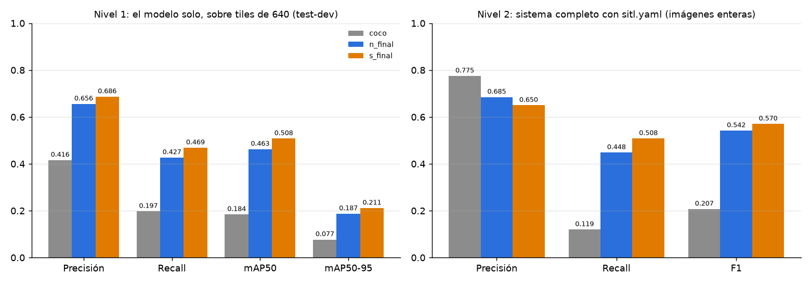
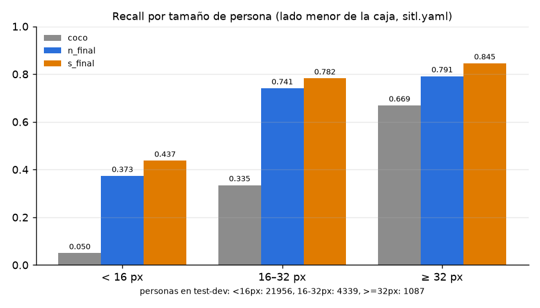
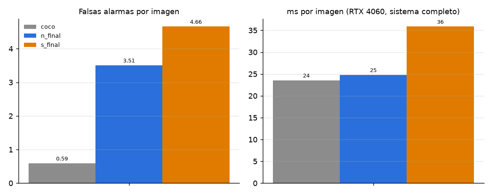
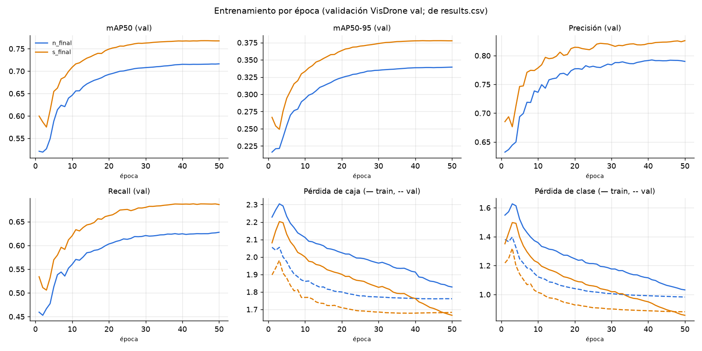

# Informe técnico: detección y geolocalización de personas desde un dron

> **Esqueleto del informe de EVAL-02 (27-11-2026).** Las secciones siguen los criterios de
> la rúbrica, en orden ([RUBRICA.md](RUBRICA.md)). Lo que ya está escrito sale de la
> documentación del repo y de ejecuciones reales, y cada dato apunta a su archivo. Las
> marcas ✏️ indican redacción y análisis **del equipo**: es lo que se evalúa en la
> defensa, y no lo puede reemplazar la IA (ver [DECLARACION_IA.md](DECLARACION_IA.md)).

Ignacio Ibañez, Gerardo González, Crsitofer Jeria · curso 02DSI243061 · sección · fecha

## Resumen

✏️ Unas 150 palabras con el problema, la solución, el resultado principal y el límite
principal. Datos que puede usar:
- El detector reentrenado encuentra el 44.8 % de las personas de VisDrone test-dev,
  contra 11.9 % de COCO (`n_final`, sistema completo).
- En SITL, el error real de ubicación fue de ~12 m.

Fuentes: [RESULTADOS.md](resultados/RESULTADOS.md) y [VALIDACION.md](VALIDACION.md) §3.

## 1. Contexto, problema y objetivos

- **Problema y usuarios:** [README, Problema, usuarios y alcance](../README.md#problema-usuarios-y-alcance).
- **Objetivo general:** detectar personas cercanas y lejanas mientras se vuela a mano,
  contarlas una vez y estimar su posición en el suelo con su error.
- **Objetivos específicos:** ✏️ derivarlos de lo anterior. Ejemplo:
  - (a) recall en personas de menos de 16 px mayor que el de COCO;
  - (b) error de ubicación medido en SITL;
  - (c) mapa en vivo para el equipo de tierra.
- **Alcance:** tabla dentro/fuera del README. El sistema **nunca comanda al dron**
  (ningún nodo publica en `/fmu/in/*`).
- ✏️ Contexto: búsqueda y rescate con drones y por qué cuesta ver personas desde 30–50 m.
  Citar fuentes reales.

## 2. Metodología, datos y arquitectura

### 2.1 Datos
VisDrone2019-DET:
- Origen, condición de uso y cita.
- Las clases `pedestrian` + `people` se unen en `person`.
- Tiles de 640 px a resolución nativa.
- Estadísticas: el 64 % de las personas de train mide menos de 16 px.

Fuente: [training/README, Datos y licencias](../training/README.md#datos-y-licencias) y
`e1_preparar_datos.py`.

### 2.2 Técnica y decisión
- YOLO11 (Ultralytics), probado en dos tamaños (`n` y `s`).
- Fine-tuning desde COCO: 50 épocas, patience 15, semilla 0, imgsz 640.
- En inferencia se usa el frame completo más tiles. Las detecciones se fusionan con
  NMS (IoU/IoS).
- Decisión: `n_final` para la Jetson.

Fuente: [training/README, Resultados](../training/README.md#resultados-visdrone-test-dev-1610-imágenes).
✏️ Explicar por qué los tiles (tamaño de las personas) y por qué no se hizo tuning.

### 2.3 Arquitectura e integración
- Diagrama de nodos y tópicos: [README, Arquitectura](../README.md#arquitectura).
- Simulación: PX4 1.17 SITL + Unreal/Cosys-AirSim. Configuración versionada en
  [`sim/airsim/`](../sim/airsim/README.md).
- Geolocalización: el rayo de cada píxel se cruza con el suelo, usando la actitud del
  dron, la cámara y el lidar (`geolocate.py`).
- Dedupe y fusión de observaciones: `persons.py`.
- ✏️ Flujo de un frame, de punta a punta, en un párrafo.

## 3. Resultados, validación y análisis crítico

### 3.1 Detector en VisDrone test-dev (1610 imágenes)

Tablas completas en [RESULTADOS.md](resultados/RESULTADOS.md), generadas por
`training/e5_resultados.py` desde `runs/eval/resumen.json`.

**Evidencia:**
- El recall del sistema pasa de 0.119 (COCO) a 0.448 (`n_final`) y a 0.508 (`s_final`).
- En personas de menos de 16 px, pasa de 0.050 a 0.373 y a 0.437.

**Costo:**
- La precisión baja de 0.775 a 0.685 y a 0.650.
- Las falsas alarmas suben de 0.59 a 3.51 y a 4.66 por imagen.

### 3.2 Entrenamiento

✏️ Leer las curvas: ¿se estabilizan antes de la época 50? ¿hay sobreajuste? (pérdida de
val y de train). ¿Por qué el mAP de val (0.716) es más alto que el de test-dev (0.463)?
RESULTADOS.md da una explicación.

### 3.3 Sistema completo en SITL
- Tests de la lógica: [VALIDACION §1](VALIDACION.md#1-tests-de-la-lógica).
- Vuelos contra la verdad de terreno de Unreal: [VALIDACION §3](VALIDACION.md#3-sistema-completo-en-sitl-contra-la-verdad-de-terreno).
  El error real es de ~12 m, mientras el sistema informa ±1.6–3.5 m; hay un sesgo de
  +9 m al norte. El vuelo 4 (`20261111_160740`, código actual, ~25 m) lo confirma:
  mediana 11.4 m contra ±2–4 m informados, sesgo +6.0 m al norte, 2 de 3 personas,
  2 duplicados y 3 falsas alarmas lejanas.
- ✏️ Conectar cada resultado con su objetivo de la sección 1: qué se cumplió, qué no y
  por qué.

### 3.4 Límites
[VALIDACION §4](VALIDACION.md#4-lo-que-no-está-validado):
- Sin dron real.
- Salto de dominio (VisDrone es real; el SITL es Unreal).
- Una sola semilla.
- ms medidos en una RTX 4060, no en la Jetson.

## 4. Ética, seguridad, impacto y limitaciones

[RIESGOS_Y_ETICA.md](RIESGOS_Y_ETICA.md):
- §1 Riesgo para las personas buscadas: falsos negativos y error subestimado.
- §2 Sesgo de los datos.
- §3 Privacidad (Ley 19.628/21.719).
- §4 Seguridad: solo lectura del autopiloto; la web no tiene contraseña.
- §5 Impacto.
- §6 Licencias.

✏️ Resumirlo y priorizar los 2–3 riesgos más graves con su mitigación.

## 5. Conclusiones y trabajo futuro

✏️ Qué se logró frente a los objetivos y qué falta: vuelo real, calibración de la
ubicación, tuning, medir en la Jetson. Lista de pendientes en [RUBRICA.md](RUBRICA.md).

## 6. Declaración de uso de IA

[DECLARACION_IA.md](DECLARACION_IA.md). ✏️ Completar las secciones del equipo.

## Referencias

Fuentes verificables, enlazadas a su origen. ✏️ Agregar las del contexto (sección 1) y
citarlas en el texto.

1. P. Zhu, L. Wen, D. Du, X. Bian, H. Fan, Q. Hu y H. Ling, "Detection and Tracking Meet
   Drones Challenge", *IEEE Transactions on Pattern Analysis and Machine Intelligence*,
   vol. 44, n.º 11, pp. 7380–7399, 2021. Dataset: <https://github.com/VisDrone/VisDrone-Dataset>.
2. G. Jocher y J. Qiu, *Ultralytics YOLO11*, 2024. <https://github.com/ultralytics/ultralytics>
   (licencia AGPL-3.0). Documentación: <https://docs.ultralytics.com/models/yolo11/>.
3. PX4 Autopilot, v1.17.0. <https://github.com/PX4/PX4-Autopilot> (BSD-3-Clause).
   uXRCE-DDS: <https://docs.px4.io/main/en/middleware/uxrce_dds.html>.
4. Cosys-Lab, *Cosys-AirSim*, 5.8-v3.4.1. <https://github.com/Cosys-Lab/Cosys-AirSim> (MIT).
5. S. Macenski, T. Foote, B. Gerkey, C. Lalancette y W. Woodall, "Robot Operating System 2:
   Design, architecture, and uses in the wild", *Science Robotics*, vol. 7, n.º 66, 2022.
   ROS 2 Jazzy: <https://docs.ros.org/en/jazzy/>.
6. F. Akyon, S. Altinuc y A. Temizel, "Slicing Aided Hyper Inference and Fine-tuning for
   Small Object Detection", *IEEE ICIP*, 2022. Es el antecedente del tiling usado en la
   inferencia. ✏️ Verificar la cita antes de usarla.
