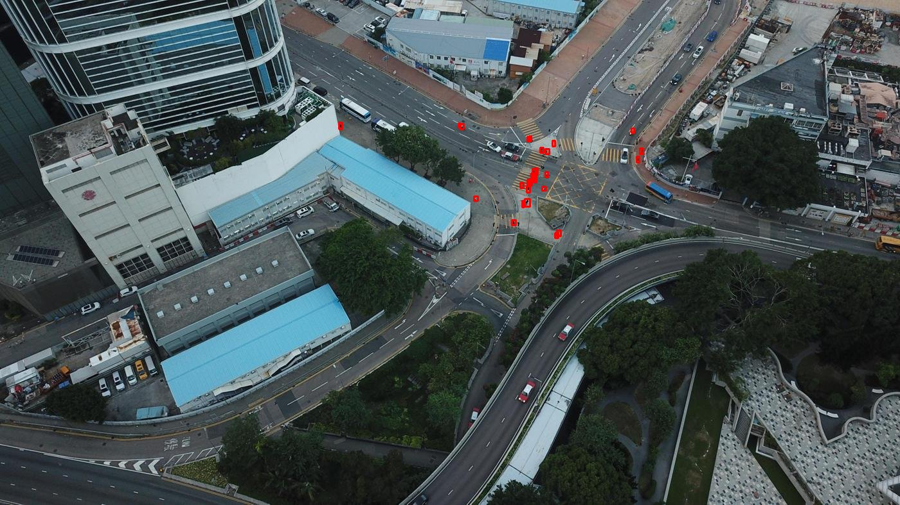
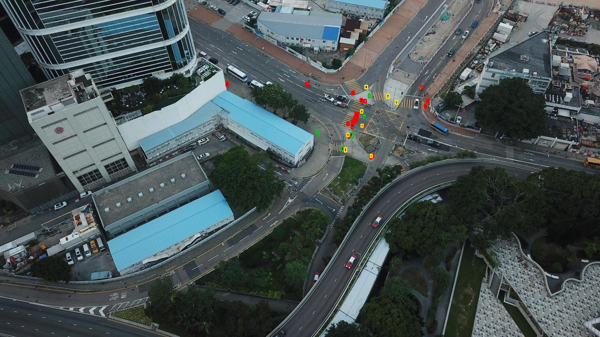

# Validación y resultados

Tres niveles de evidencia, de lo más controlado a lo más cercano al uso real. Todas
las cifras salen de ejecuciones reales. El archivo de origen está indicado en cada caso
y copiado en [`resultados/`](resultados/).

| Nivel | Qué mide | Datos | Herramienta | Estado |
|---|---|---|---|---|
| 1. Lógica | Que cada pieza haga lo que dice (tiling, NMS, tracker, deduplicación, geolocalización, mapa) | Casos sintéticos, incluidos casos límite | `pytest` (sin ROS) | ✅ 140 tests en verde |
| 2. Detector | Cuántas personas encuentra y cuántas inventa | VisDrone test-dev, 1610 imágenes etiquetadas | `training/evaluate.py` | ✅ hecho |
| 3. Sistema en SITL | Si el punto del mapa cae donde está la persona | Vuelos en Unreal + posición real de cada actor | `scripts/verdad_sitl.py` | ⚠️ 3 vuelos, resultados malos de ubicación (ver abajo) |
| 4. Dron real | Todo lo anterior con cámara y GPS reales | — | — | ❌ no hecho |

---

## 1. Tests de la lógica

```bash
cd src/person_yolo && python3 -m pytest -q test
```

Salida guardada: [`resultados/pytest.txt`](resultados/pytest.txt) (140 passed, 2026-11-10).

| Archivo | Qué cubre, incluidos los casos límite |
|---|---|
| `test_tiling.py` | Tiles que cubren toda la imagen con solape; cajas cortadas en el borde; NMS por IoU e IoS |
| `test_inference.py` | Frame completo + tiles + fusión con un modelo falso; imagen más chica que un tile |
| `test_tracker.py` | Una persona cuenta una sola vez; un falso positivo de un frame no cuenta; persona lejana que solo aparece en frames con tiles; inferencia lenta; movimiento rápido |
| `test_persons.py` | Waypoint tras `min_seen_sec`; un falso positivo corto nunca llega al mapa; aproximadas; duplicados de alguien que sale y vuelve; dos personas vistas a la vez nunca se fusionan; fusión de posiciones con descarte de valores atípicos |
| `test_geolocate.py` | Rayo píxel → suelo con yaw, pitch y roll; rayo rasante o sobre el horizonte = no ubica; error crece con la incidencia; actitud o GPS inválidos |
| `test_history.py` | Muestra del estado del dron más cercana al instante de la imagen; stamp que vuelve atrás (rosbag en loop) |
| `test_trail.py`, `test_web_map.py` | Archivos KML/GeoJSON/CSV, marcas manuales, servidor web |
| `test_overlay.py`, `test_model_path.py` | Dibujos del HUD; dónde se busca el peso |
| `test_airsim_settings.py` | Que la cámara y el lidar de `sim/airsim/settings*.json` coincidan con `config/sitl.yaml` y `launch_sitl.sh` |

---

## 2. Detector en VisDrone test-dev

Detalle, decisiones y lectura en [`training/README.md`](../training/README.md#resultados-visdrone-test-dev-1610-imágenes).
Datos: [`resultados/resumen.md`](resultados/resumen.md), [`resumen.json`](resultados/resumen.json)
y las fichas de cada modelo ([`ficha_n_final.json`](resultados/ficha_n_final.json),
[`ficha_s_final.json`](resultados/ficha_s_final.json)).

Sistema completo con `sitl.yaml`, IoU 0.5:

| Modelo | Precisión | Recall | Recall <16 px | F1 | Falsas alarmas/img | ms/img (RTX 4060) |
|---|---|---|---|---|---|---|
| COCO `yolo11n` | 0.775 | 0.119 | 0.050 | 0.207 | 0.59 | 24 |
| `n_final` | 0.685 | 0.448 | 0.373 | 0.542 | 3.51 | 25 |
| `s_final` | 0.650 | 0.508 | 0.437 | 0.570 | 4.66 | 36 |

Ejemplo, la misma imagen con cada modelo. **Verde** = persona encontrada, **rojo** =
persona no encontrada, **amarillo** = falsa alarma:

| COCO | `n_final` | `s_final` |
|---|---|---|
|  |  |  |

COCO no encuentra a ninguna de las personas del cruce, todas de pocos píxeles.
`n_final` encuentra varias y agrega falsas alarmas. Algunas de esas falsas alarmas
podrían ser personas que VisDrone no anotó; no se revisó a mano.

Curvas de entrenamiento: [`img/curvas_n_final.png`](resultados/img/curvas_n_final.png),
[`img/curvas_s_final.png`](resultados/img/curvas_s_final.png). Curvas
precisión-recall: [`img/pr_n_final.png`](resultados/img/pr_n_final.png),
[`img/pr_s_final.png`](resultados/img/pr_s_final.png).

---

## 3. Sistema completo en SITL, contra la verdad de terreno

**Método:** se vuela a mano en Unreal con 3 personas (actores `StaticMeshActor_1/3/4`)
puestas en la escena. Al terminar, `verdad_sitl.py` le pide a AirSim la posición real de
cada actor y la pasa a lat/lon con el mismo GPS simulado del dron. Después compara cada
punto de `personas.csv` con la persona real más cercana. Un punto a más de 15 m de toda
persona cuenta como falsa alarma.

Reproducir sin Unreal, con los archivos guardados:

```bash
python3 scripts/verdad_sitl.py --sin-airsim --vuelo docs/resultados/sitl/20261110_152146
```

Datos de cada vuelo en [`resultados/sitl/`](resultados/sitl/): `personas.csv`, `verdad.csv`,
`trail.geojson`, `verdad.geojson` (se abren juntos en geojson.io) e `informe.txt`.

| Vuelo | Versión del código | Duración / altura máx. | Personas encontradas | Puntos marcados | Duplicados | Aproximados (sin posición) | Error real de los ubicados | Error que informa el sistema |
|---|---|---|---|---|---|---|---|---|
| `20261110_145432` | `19a97cc` | 192 s / 3.7 m | 2 de 3 | 20 | 3 | 14 lejos de toda persona | mediana 11.6 m, máx 11.9 m | ±1.2–1.3 m |
| `20261110_151145` | `f9fdb56` | sin despegar | 0 de 3 | 2 | 0 | 2 (falsas alarmas en tierra) | — | — |
| `20261110_152146` | `f9fdb56` | 128 s / 33.2 m | 2 de 3 | 7 | 2 | 1 | mediana 11.8 m, máx 14.8 m | ±1.6–17.3 m |

"Versión del código" es el último commit anterior a la hora del vuelo. Ninguno se voló
con la versión actual (`b86618a`, que cambia la fusión de posiciones y los duplicados).

**Lectura:**
- **El error de ubicación está subestimado.** Con el dron a 33 m, el error real es de
  unos 12 m, y el sistema dice ±1.6–3.5 m en 4 de sus 6 puntos ubicados. En el vuelo 3 todos los
  puntos se corren en promedio **+9.1 m al norte**. Que vayan todos para el mismo lado
  apunta a un error sistemático (pitch de la cámara, retraso de la imagen o altura), no a
  ruido. `scripts/calibrar_geo.py` está hecho para medir ese error con un rosbag y la
  verdad de terreno. **Todavía no se corrió.**
- **Volando bajo casi nada se ubica.** A 3.7 m de altura, el rayo hacia una persona a
  20–50 m pasa los 80° de incidencia (`max_incidence_deg`). Esas personas quedan
  "aproximadas" en la posición del dron y se repiten (14 de 20 puntos en el vuelo 1).
  Es el comportamiento diseñado, pero muestra que el sistema necesita altura para servir.
- **Duplicados:** 2–3 por vuelo. La versión `b86618a` agregó la fusión de duplicados
  después de estos vuelos; falta medir si los reduce.
- **Falsas alarmas en tierra** (vuelo 2): con el dron apoyado, el detector marcó 2
  personas inexistentes, con score 0.25 y 0.40. Son scores bajos, cerca del umbral de
  tiles (0.25).
- **Muestra chica:** 3 personas y 2 vuelos útiles. Sirve para encontrar problemas, no
  para dar un porcentaje de acierto.

**Próximos pasos de validación:**
1. Volar con la versión actual a 20–40 m, con rosbag (`ros2 bag record /camera /drone/... `).
2. `calibrar_geo.py` con ese rosbag → corregir `camera_pitch_deg` / `image_delay_sec`.
3. Repetir `verdad_sitl.py` y comparar la mediana de error real antes y después.
4. `training/comparar.py` sobre el mismo rosbag para ver COCO, `n` y `s` en el dominio
   Unreal.

---

## 4. Lo que no está validado

- **Dron real:** no se voló con la Jetson. Las cifras de tiempo son de una RTX 4060, no de
  la Orin NX con TensorRT.
- **Modelos VisDrone en SITL:** los vuelos con verdad de terreno usaron el peso por defecto
  de `sitl.yaml` (COCO `yolo11n.pt`), salvo que se haya lanzado con `MODEL=` (no quedó
  registrado).
- **Personas en movimiento:** `verdad_sitl.py` supone personas quietas.
