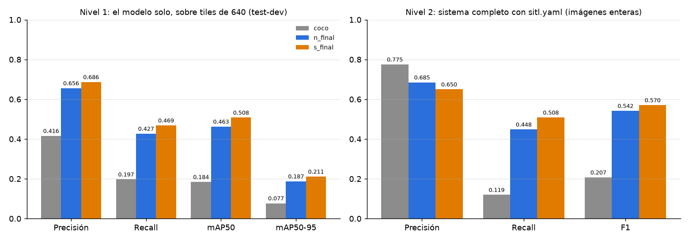
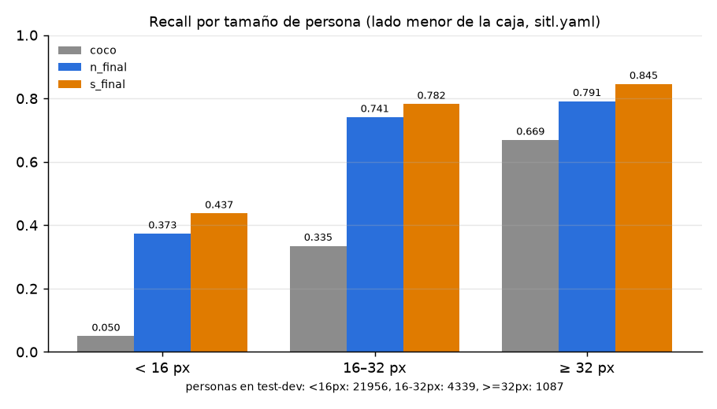
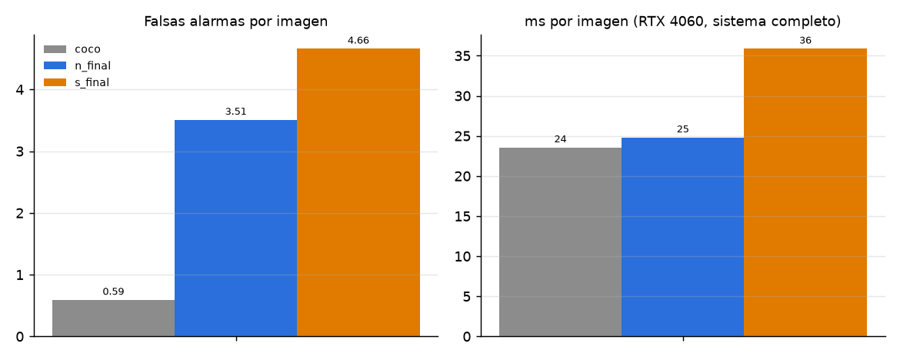
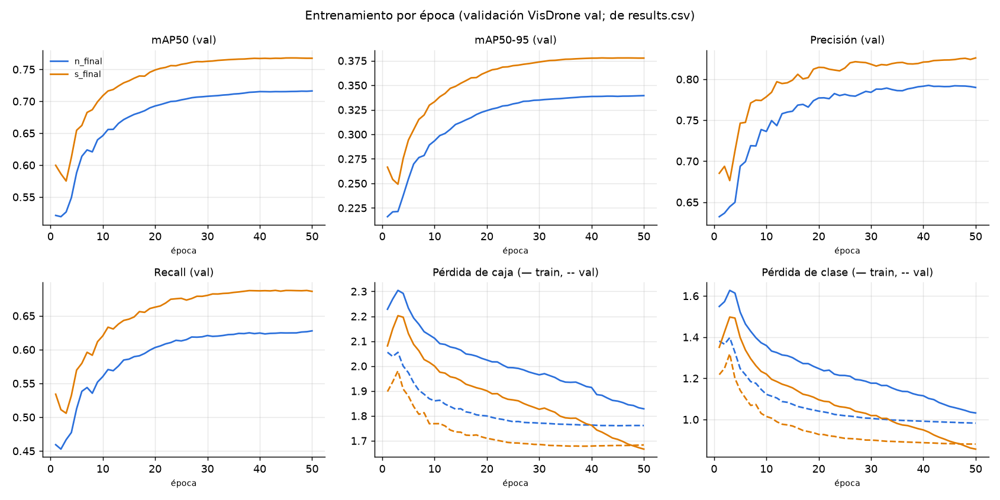

# Resultados de los modelos

Cifras de `training/runs/eval/resumen.json` (salida de `e3_evaluar.py` sobre VisDrone2019-DET test-dev, 1610 imágenes) y de `training/runs/train/<run>/results.csv` y `ficha_modelo.json` (salida de `e2_entrenar.py`). Generado por `training/e5_resultados.py`: no hay números escritos a mano.

En detección de objetos no se usa *accuracy* (no hay "negativos verdaderos" que contar: el fondo es infinito). Lo equivalente es precisión, recall, F1 y mAP; ver el glosario al final.

## Nivel 1: el modelo solo (tiles de 640, Ultralytics val)

| Modelo | Pesos | Precisión | Recall | mAP50 | mAP50-95 |
|---|---|---|---|---|---|
| coco | yolo11n.pt | 0.416 | 0.197 | 0.184 | 0.077 |
| n_final | runs/train/n_final/weights/best.pt | 0.656 | 0.427 | 0.463 | 0.187 |
| s_final | runs/train/s_final/weights/best.pt | 0.686 | 0.469 | 0.508 | 0.211 |

## Nivel 2: sistema completo con `sitl.yaml`

Imágenes enteras por `detect_persons()` (frame completo + tiles + fusión) a los umbrales reales del detector.

| Modelo | Precisión | Recall | F1 | Recall <16 px | Recall 16–32 px | Recall ≥32 px | Falsas alarmas/img | ms/img | Imágenes |
|---|---|---|---|---|---|---|---|---|---|
| coco | 0.775 | 0.119 | 0.207 | 0.050 | 0.335 | 0.669 | 0.59 | 24 | 1610 |
| n_final | 0.685 | 0.448 | 0.542 | 0.373 | 0.741 | 0.791 | 3.51 | 25 | 1610 |
| s_final | 0.650 | 0.508 | 0.570 | 0.437 | 0.782 | 0.845 | 4.66 | 36 | 1610 |

## Nivel 2: sistema completo con `jetson.yaml`

Imágenes enteras por `detect_persons()` (frame completo + tiles + fusión) a los umbrales reales del detector.

| Modelo | Precisión | Recall | F1 | Recall <16 px | Recall 16–32 px | Recall ≥32 px | Falsas alarmas/img | ms/img | Imágenes |
|---|---|---|---|---|---|---|---|---|---|
| coco | 0.774 | 0.120 | 0.207 | 0.050 | 0.335 | 0.673 | 0.60 | 25 | 1610 |
| n_final | 0.685 | 0.448 | 0.542 | 0.374 | 0.740 | 0.793 | 3.51 | 25 | 1610 |
| s_final | 0.651 | 0.510 | 0.572 | 0.439 | 0.783 | 0.846 | 4.65 | 36 | 1610 |

## Entrenamiento

| Run | Base | Épocas | Mejor época (mAP50-95 val) | mAP50 val | mAP50-95 val | Horas | Entorno |
|---|---|---|---|---|---|---|---|
| n_final | yolo11n.pt | 50 | 50 | 0.716 | 0.339 | 2.9 | NVIDIA GeForce RTX 4060, ultralytics 8.4.208 |
| s_final | yolo11s.pt | 50 | 42 | 0.767 | 0.378 | 4.2 | NVIDIA GeForce RTX 4060, ultralytics 8.4.208 |

El mAP de val es más alto que el de test-dev: val se usó para quedarse con la mejor época (`best.pt`), y test-dev tiene más personas chicas (83 % de menos de 16 px, contra 70 % en val; tabla de `training/README.md`). La cifra que vale para comparar es la de test-dev.

## Gráficos

### Métricas de los modelos en los dos niveles

### Recall según el tamaño de la persona en la imagen

### Costo: falsas alarmas y tiempo

### Curvas de entrenamiento de n_final y s_final

## Glosario

- **Precisión**: De las detecciones, cuántas eran personas de verdad. Baja = muchas falsas alarmas.
- **Recall**: De las personas etiquetadas, cuántas se encontraron. Baja = personas perdidas.
- **F1**: Media armónica de precisión y recall: un solo número que pide las dos.
- **mAP50**: Promedio de la precisión en todos los umbrales de score, contando como acierto una caja con IoU ≥ 0.5 con la etiquetada. Estándar de VisDrone.
- **mAP50-95**: Lo mismo promediando IoU de 0.5 a 0.95: exige cajas más justas.
- **Falsas alarmas/img**: Detecciones sin persona etiquetada, por imagen de test-dev.
- **ms/img**: Tiempo del sistema completo por imagen en la GPU de evaluación (RTX 4060), no en la Jetson.

Lectura y decisión: [`training/README.md`](../../training/README.md#resultados-visdrone-test-dev-1610-imágenes). Límites de esta evaluación: [`docs/VALIDACION.md`](../VALIDACION.md).
